# Zyricon — Unified Full-Stack & GenAI Workspace

> A production-grade Full-Stack web application combining **Google OAuth 2.0**, PostgreSQL **Row Level Security (RLS)**, PostgreSQL **RPC Procedures**, and a serverless **Supabase Deno Edge Function** communicating directly with the **Google Gemini 2.5 Flash REST API**.

[](https://react.dev/)
[](https://vitejs.dev/)
[](https://tailwindcss.com/)
[](https://supabase.com/)
[](https://ai.google.dev/)
[](https://deno.land/)

---

## ⚡ Core Highlights & Capabilities

### 1. Google OAuth 2.0 Authentication & Session Management
- Seamless sign-in via Supabase Auth using the standard OAuth 2.0 PKCE flow.
- Integrates Google account metadata (display name, email, avatar).
- Dedicated login landing screen with interactive AI orb branding and configuration diagnostics.

### 2. PostgreSQL Audit Logging with Row Level Security (RLS)
- **Automatic Event Tracking**: Logs sign-ins directly to `public.login_logs` upon successful authentication.
- **Strict RLS Enforcement**: Declarative PostgreSQL policies (`Users can insert own login` using `auth.uid() = user_id`, `Authenticated users can view logins`).
- **Duplicate Prevention Guard**: Dual-layer synchronous in-memory lock (`useRef<Set>`) and browser `sessionStorage` guard, preventing duplicate database writes during React 18 StrictMode double-invocations, tab refocusing, or token refresh cycles.

### 3. PostgreSQL RPC Function (`get_recent_logins`)
- Encapsulated PL/pgSQL function executing with `security invoker` rights to retrieve the 50 most recent verified sessions.
- **Client Search & Telemetry**: Instant client-side filtering by name, email, or date; display of relative timestamps (`2m ago`, `Just now`); and copyable UUIDs.
- **Data Exporting**: Direct export of audit session records to **CSV** spreadsheet or structured **JSON** format.
- **Real-Time Channel**: Silent background Supabase `postgres_changes` listener ensuring the log stays up-to-date across multiple devices.

### 4. Serverless Edge Computing Layer (`gemini-chat`)
- Hosted on Supabase Edge Functions built on the ultra-low latency **Deno runtime**.
- **API Secret Concealment**: `GEMINI_API_KEY` is completely isolated in server-side Deno environment secrets, preventing any browser-side exposure.
- **Google Gemini 2.5 Flash**: Direct integration with the `v1beta` endpoint (`gemini-2.5-flash`), supporting model switching and fallback to `gemini-2.0-flash`.
- **CORS & Resilience**: Full preflight `OPTIONS` handling, permissive headers, and clean error forwarding.

### 5. Premier Dark Studio UI & Ergonomics
- **Centered Highlight Switcher**: Prominent, typography-first view switcher toggle in the workspace header between **Gemini Chat** and **Audit Log**.
- **Collapsible Sidebar**:
  - Independent thread creation and deletion with per-user email `localStorage` persistence.
  - Engineering quick-start context prompts (*RLS & RPC Security*, *Deno Edge & CORS*, *Duplicate Login Guard*).
  - In-app interactive **Technical Report Modal** and **PostgreSQL Schema & RLS viewer**.
  - Dynamic user identity card that auto-resolves Google account avatars or domain logos (with vector Gmail icon fallback) and a full-width logout action.
- **Toolbar Utilities**: Model switcher dropdown, Configuration modal (temperature slider, system persona), and one-click Markdown transcript exporter.

---

## 🏗️ System Architecture & Visual Workflows

### 1. High-Level Component & Cloud Topology
```mermaid
flowchart TD
    subgraph Client["Client Tier (React 18 + Vite)"]
        direction TB
        AppRoot["App.jsx Orchestrator"]
        Sidebar["Sidebar.jsx (Threads & Identity)"]
        Navbar["Navbar.jsx (Centered Switcher & Models)"]
        AuditView["LoginAuditLog.jsx (Audit Table & Metrics)"]
        ChatView["GeminiChatbot.jsx (AI Chat & Telemetry)"]
        AppRoot --> Sidebar
        AppRoot --> Navbar
        AppRoot --> AuditView
        AppRoot --> ChatView
    end

    subgraph SupabasePlatform["Supabase Cloud Platform"]
        direction TB
        AuthSvc["Supabase Auth (OAuth PKCE)"]
        PostgresDB[("PostgreSQL Database")]
        RLSEngine{"Row Level Security (RLS)"}
        RPCProc["RPC: get_recent_logins()"]
        RealtimeCh["Realtime Engine (postgres_changes)"]
        DenoEdge["Deno Edge Function (gemini-chat)"]
        SecretVault["Encrypted Secrets (GEMINI_API_KEY)"]
        
        PostgresDB --- RLSEngine
        PostgresDB --- RealtimeCh
    end

    subgraph ExternalServices["External Cloud APIs"]
        GoogleAuth["Google OAuth 2.0 Accounts"]
        GeminiFlash["Google Gemini 2.5 Flash API"]
    end

    %% Auth & User Journey
    AppRoot -->|"1. Initiate OAuth"| AuthSvc
    AuthSvc <-->|"2. Token Exchange"| GoogleAuth
    AppRoot -->|"3. Guarded Session Insert"| RLSEngine
    RLSEngine -->|"4. Validated Insert (login_logs)"| PostgresDB
    RealtimeCh -.->|"5. Broadcast INSERT Event"| AuditView
    AuditView -->|"6. Query Logs via RPC"| RPCProc
    RPCProc -->|"7. Security Invoker Query"| PostgresDB

    %% AI Journey
    ChatView -->|"8. POST prompt + history"| DenoEdge
    DenoEdge -->|"9. Retrieve Secret"| SecretVault
    DenoEdge -->|"10. POST /v1beta/models/gemini-2.5-flash"| GeminiFlash
    GeminiFlash -->>|"11. AI Response"| DenoEdge
    DenoEdge -->>|"12. Formatted Markdown Response"| ChatView
```

### 2. Authentication, Duplicate-Guard & Audit Logging Workflow

```mermaid
sequenceDiagram
    autonumber
    actor User as User Browser
    participant App as App.jsx (React Root)
    participant Auth as Supabase Auth (OAuth)
    participant DB as PostgreSQL (public.login_logs)
    participant RPC as RPC (get_recent_logins)
    participant Audit as LoginAuditLog Component

    User->>App: Clicks "Sign in with Google"
    App->>Auth: signInWithOAuth({ provider: 'google' })
    Auth->>User: Redirects to Google consent screen
    User->>Auth: Approves permissions & redirects back
    Auth->>App: onAuthStateChange('SIGNED_IN', session)
    
    rect rgb(30, 20, 45)
    Note over App: Client Duplicate Prevention Guard
    alt Session is NOT in memory Set AND NOT in sessionStorage
        App->>App: Add user_id to in-memory lock Set
        App->>App: Set sessionStorage('logged_session_[user_id]')
        App->>DB: INSERT into public.login_logs (user_id, email, full_name, avatar_url)
        Note over DB: Evaluated against RLS Policy:<br/>"Users can insert own login" (auth.uid() = user_id)
        DB-->>App: Insert Confirmed
    else Session already logged
        App->>App: Skip duplicate DB write (React 18 StrictMode / Token refresh)
    end
    end

    Audit->>RPC: supabase.rpc('get_recent_logins')
    RPC->>DB: SELECT * FROM login_logs ORDER BY logged_in_at DESC LIMIT 50
    DB-->>RPC: Returns verified audit log dataset
    RPC-->>Audit: Populates real-time table, search filters & metrics
```


### 3. Serverless Edge Computing & Gemini AI Pipeline

```mermaid
sequenceDiagram
    autonumber
    actor User as User
    participant ChatUI as GeminiChatbot.jsx
    participant Edge as Deno Edge Function (gemini-chat)
    participant Vault as Supabase Secrets Vault
    participant Gemini as Google Gemini 2.5 Flash API

    User->>ChatUI: Types prompt (or clicks Preset Topic)
    ChatUI->>ChatUI: Optimistically appends message & starts stopwatch
    ChatUI->>Edge: POST /functions/v1/gemini-chat (messages, model, temperature)
    
    rect rgb(20, 30, 45)
    Note over Edge: Serverless Deno Edge Execution
    Edge->>Edge: Handle CORS OPTIONS preflight
    Edge->>Vault: Read Deno.env.get('GEMINI_API_KEY')
    Vault-->>Edge: Secure API Key
    Edge->>Gemini: POST /v1beta/models/gemini-2.5-flash:generateContent
    Gemini-->>Edge: 200 OK (candidates, content, safetyRatings)
    Edge-->>ChatUI: JSON payload with generated markdown
    end

    ChatUI->>ChatUI: Records response latency (e.g., 620ms)
    ChatUI->>ChatUI: Renders markdown, syntax highlighted code, and copy actions
    ChatUI->>ChatUI: Syncs conversation to localStorage (keyed by user email)
```


---

## 🛠️ Tech Stack & Dependencies

| Layer | Technologies |
| :--- | :--- |
| **Frontend Framework** | React 18.3, Vite 6.1 |
| **Styling & Icons** | Tailwind CSS 3.4, Lucide React, Custom SVG Icons |
| **Database & Auth** | Supabase JS v2, PostgreSQL 15, Row Level Security (RLS) |
| **Backend & Compute** | Supabase Edge Functions (Deno, TypeScript) |
| **Generative AI** | Google Gemini 2.5 Flash (`v1beta` REST API) |

---

## 🚀 Getting Started

### 1. Prerequisites
- [Node.js](https://nodejs.org/) (v18 or higher)
- [Supabase Account](https://supabase.com/) & Project
- [Google AI Studio](https://aistudio.google.com/) Gemini API Key

### 2. Clone Repository
```bash
git clone https://github.com/Bored008/SupabaseAndGeminiChatBot.git
cd SupabaseAndGeminiChatBot
npm install
```

### 3. Configure Environment Variables
Create a `.env` file in the project root based on [`.env.example`](.env.example):
```env
VITE_SUPABASE_URL=https://your-project-ref.supabase.co
VITE_SUPABASE_ANON_KEY=your-supabase-anon-key
```

### 4. Deploy Database Schema & RPC
Open your **Supabase Dashboard** -> **SQL Editor**, and run the SQL migration script from [`supabase/schema.sql`](supabase/schema.sql):

```sql
-- 1. Create Login Logs Table
create table if not exists public.login_logs (
    id uuid primary key default gen_random_uuid(),
    user_id uuid references auth.users(id) on delete cascade not null,
    email text not null,
    full_name text,
    avatar_url text,
    logged_in_at timestamptz default timezone('utc'::text, now()) not null
);

-- 2. Enable RLS
alter table public.login_logs enable row level security;

-- 3. Declarative RLS Policies
create policy "Users can insert own login"
    on public.login_logs
    for insert
    to authenticated
    with check (auth.uid() = user_id);

create policy "Authenticated users can view logins"
    on public.login_logs
    for select
    to authenticated
    using (true);

-- 4. RPC Procedure
create or replace function public.get_recent_logins()
returns table (
    id uuid,
    email text,
    full_name text,
    avatar_url text,
    logged_in_at timestamptz
)
language sql
security invoker
as $$
    select id, email, full_name, avatar_url, logged_in_at
    from public.login_logs
    order by logged_in_at desc
    limit 50;
$$;
```

### 5. Deploy the Supabase Edge Function
Install the Supabase CLI and deploy the serverless Deno Edge Function:

```bash
# Login and link your remote Supabase project
npx supabase login
npx supabase link --project-ref <your-supabase-project-id>

# Store your Google Gemini API key securely in Supabase Secrets
npx supabase secrets set GEMINI_API_KEY=<your-gemini-api-key>

# Deploy the function
npx supabase functions deploy gemini-chat
```

### 6. Run the Application

```bash
# Start Vite development server
npm run dev

# Or build for production
npm run build
npm run preview
```

Open your browser at **`http://localhost:5173`**.

---

## 📁 Repository Directory Structure

```text
.
├── supabase/
│   ├── schema.sql                     # Table schema, RLS policies & RPC function
│   └── functions/
│       └── gemini-chat/
│           └── index.ts               # Deno Edge Function proxying Gemini 2.5 Flash
├── src/
│   ├── assets/
│   │   └── zyricon-orb.png            # Visual AI orb branding asset
│   ├── components/
│   │   ├── GeminiChatbot.jsx          # AI Chat interface, markdown rendering & telemetry
│   │   ├── LoginAuditLog.jsx          # RPC audit log table with CSV/JSON export & search
│   │   ├── LoginPage.jsx              # Google OAuth 2.0 sign-in landing screen
│   │   ├── Navbar.jsx                 # Workspace toolbar, centered switcher & model pill
│   │   ├── Sidebar.jsx                # Collapsible navigation, threads, and identity card
│   │   ├── TechnicalReportModal.jsx   # In-app architecture & technical documentation modal
│   │   └── ZyriconIcons.jsx           # Crisp vector icons (emblems, Gmail 4-color SVG, etc.)
│   ├── lib/
│   │   └── supabaseClient.js          # Initialized Supabase client with config guards
│   ├── App.jsx                        # Main workspace orchestrator & duplicate login guard
│   ├── index.css                      # Tailwind styling, ambient glows & custom scrollbars
│   └── main.jsx                       # React DOM entrypoint
├── .env.example                       # Environment variable template
├── REPORT.md                          # Full submission technical report
├── SPEC.md                            # Functional specification document
└── package.json                       # Project dependencies and build scripts
```

---

## 🔒 Security Architecture Summary

1. **Authentication (PKCE)**: Uses Supabase Auth PKCE flow to exchange authorization codes securely without exposing tokens in browser history.
2. **Row Level Security (RLS)**: Protects `public.login_logs` directly in PostgreSQL. Even if client-side code is modified by an attacker, the database rejects any `INSERT` where `user_id != auth.uid()`.
3. **RPC Encapsulation**: The procedure `get_recent_logins()` runs with `security invoker` rights, ensuring query execution complies with the calling user's active permissions.
4. **Zero-Secret Client**: The `GEMINI_API_KEY` is never bundled in frontend code or transmitted over client networks; it exists exclusively inside the server-side Deno Edge Function environment.

---

## 📄 Documentation Links
- **Technical Report**: [`REPORT.md`](REPORT.md)
- **Specification Document**: [`SPEC.md`](SPEC.md)

---

## 📜 License
This project is open-source and available under the [MIT License](LICENSE).
