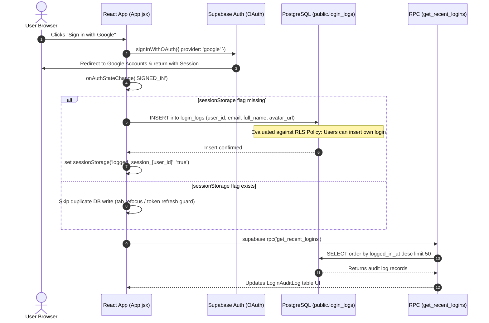
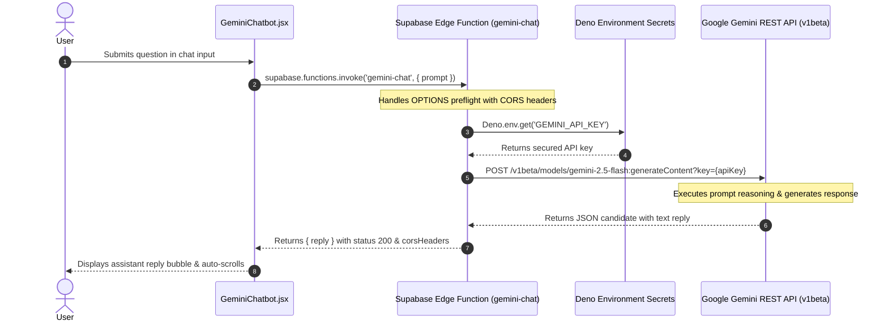

# Technical Submission Report: FS-GenAI Unified Assessment Web Application

**Author / Candidate:** Full-Stack & GenAI Intern Candidate  
**Project:** Unified Assessment Application (Supabase Core + Google OAuth Audit Log + Gemini 2.5 Flash Edge Chatbot)  
**Date:** October 2026  

---

## 1. Executive Summary & Architecture Overview

This project unifies three core backend and frontend engineering tasks into a production-grade, highly cohesive single-page dashboard:
1. **Supabase Core Integration (Task 1):** Database schema modeling, declarative PostgreSQL Row Level Security (RLS) policies, Remote Procedure Call (RPC) functions, and serverless Deno Edge Functions.
2. **Google OAuth & Login Audit Logging (Task 2):** Secure OAuth 2.0 authentication flow with automatic login event tracking into a protected PostgreSQL table, fortified against duplicate logging and surfaced via an RPC function.
3. **Gemini AI Chatbot via Edge Function (Task 3):** Serverless Edge computing layer that securely proxies user prompts to the Google Gemini 2.5 Flash REST API (`v1beta`), enforcing strict Cross-Origin Resource Sharing (CORS) headers and concealing sensitive API secrets from browser environments.

### Tech Stack
| Component | Technology | Role / Purpose |
| :--- | :--- | :--- |
| **Frontend Framework** | React 18 + Vite | High-performance SPA with fast HMR |
| **Styling & UI** | Tailwind CSS + Lucide Icons | Responsive modern dark-mode dashboard |
| **Authentication** | Supabase Auth (Google OAuth) | OAuth 2.0 PKCE flow & JWT session management |
| **Database** | PostgreSQL on Supabase | Relational data persistence with RLS |
| **Security Layer** | PostgreSQL Row Level Security (RLS) | Declarative access control per authenticated user |
| **Database API** | PostgreSQL RPC (`get_recent_logins`) | Encapsulated server-side query execution |
| **Serverless Compute** | Supabase Edge Functions (Deno) | Low-latency edge handler (`gemini-chat`) |
| **Artificial Intelligence** | Google Gemini 3.5 Flash API | `generateContent` endpoint (`v1beta`) |

---

## 2. Architecture Diagrams

### 2.1 User Authentication & Audit Log Flow



### 2.2 Serverless Gemini Edge Function Flow



---

## 3. Deep Dive Technical Implementation

### 3.1 Database Modeling & Row Level Security (RLS)
The database schema is defined in [`supabase/schema.sql`](file:///c:/Coding/Projects/FSInternAssignment/supabase/schema.sql):

- **Data Integrity:** The `public.login_logs` table links directly to `auth.users(id)` via a foreign key constraint with `ON DELETE CASCADE`. If a user account is deleted, their associated audit records are safely cleaned up.
- **Enabling RLS:** `ALTER TABLE public.login_logs ENABLE ROW LEVEL SECURITY;` ensures that direct client access is locked down by default.
- **Policy 1: Insert Protection (`Users can insert own login`):**
  ```sql
  create policy "Users can insert own login"
  on public.login_logs
  for insert
  to authenticated
  with check (auth.uid() = user_id);
  ```
  This policy verifies that an incoming insert request can only record a row where the `user_id` matches the caller's cryptographically verified JWT (`auth.uid()`). No user can spoof a login entry on behalf of someone else.
- **Policy 2: Read Access (`Authenticated users can view logins`):**
  ```sql
  create policy "Authenticated users can view logins"
  on public.login_logs
  for select
  to authenticated
  using (true);
  ```
  Restricts read access strictly to authenticated users, protecting audit telemetry from public web scrapers while allowing team members to see shared activity.

### 3.2 Remote Procedure Call (RPC) Architecture
Rather than executing arbitrary queries from the React client, we implemented a custom PostgreSQL function:
```sql
create or replace function public.get_recent_logins()
returns table (
  id uuid,
  email text,
  full_name text,
  avatar_url text,
  logged_in_at timestamptz
)
language sql
security invoker
as $$
  select id, email, full_name, avatar_url, logged_in_at
  from public.login_logs
  order by logged_in_at desc
  limit 50;
$$;
```
**Why `security invoker`?**
Using `security invoker` guarantees that the function executes with the permissions of the calling user. It preserves Row Level Security checks while encapsulating sorting (`ORDER BY logged_in_at DESC`) and pagination limits (`LIMIT 50`) on the database server.

### 3.3 Duplicate Login Guard (Concurrency & StrictMode Safe)
`supabase.auth.onAuthStateChange` emits `SIGNED_IN` events on initial authentication, tab refocus, or token refresh. Additionally, React 18's `StrictMode` in development mounts effects concurrently. To prevent race conditions where parallel async handlers execute before a session flag is stored:
```javascript
const loggingLockRef = useRef(new Set());

// Synchronous check & instant lock BEFORE awaiting the network insert
if (sessionStorage.getItem(sessionKey) || loggingLockRef.current.has(user.id)) {
  return;
}
loggingLockRef.current.add(user.id);
sessionStorage.setItem(sessionKey, 'true');

await supabase.from('login_logs').insert([ ... ]);
```
This guarantees strictly **one** audit log entry per user session. When the user clicks "Sign Out", `sessionStorage` and memory locks are cleared.

### 3.4 Supabase Edge Function & Gemini API (`gemini-chat`)
The Edge Function is authored in TypeScript for the Deno runtime in [`supabase/functions/gemini-chat/index.ts`](file:///c:/Coding/Projects/FSInternAssignment/supabase/functions/gemini-chat/index.ts):
- **Secret Isolation:** The `GEMINI_API_KEY` is retrieved from server environment variables via `Deno.env.get('GEMINI_API_KEY')`. The secret is never transmitted to or embedded inside the browser client.
- **CORS Handling:** Handles both `OPTIONS` preflight requests and all response statuses (`200`, `400`, `500`) with consistent CORS headers:
  ```typescript
  const corsHeaders = {
    'Access-Control-Allow-Origin': '*',
    'Access-Control-Allow-Headers': 'authorization, x-client-info, apikey, content-type',
  };
  ```
- **Lightweight REST Invocation:** Uses standard `fetch` against Google's `gemini-2.5-flash:generateContent` REST endpoint, eliminating heavyweight Node.js SDK bundling overhead and ensuring near-instant edge cold starts.

---

## 4. Setup and Deployment Instructions

### 4.1 Running Locally

1. **Clone & Install Dependencies:**
   ```bash
   cd FSInternAssignment
   npm install
   ```

2. **Configure Environment Variables:**
   Create a `.env` file in the project root:
   ```env
   VITE_SUPABASE_URL=https://<your-project-ref>.supabase.co
   VITE_SUPABASE_ANON_KEY=<your-supabase-anon-key>
   ```

3. **Deploy Database Schema:**
   Open the **Supabase Dashboard** -> **SQL Editor**, paste the contents of `supabase/schema.sql`, and click **Run**.

4. **Deploy Edge Function & Set Secrets:**
   ```bash
   # Login to Supabase CLI
   npx supabase login

   # Link your project
   npx supabase link --project-ref <your-project-ref>

   # Set Gemini API key secret
   npx supabase secrets set GEMINI_API_KEY=<your-google-gemini-api-key>

   # Deploy the edge function
   npx supabase functions deploy gemini-chat
   ```

5. **Start Development Server:**
   ```bash
   npm run dev
   ```
   Open `http://localhost:5173` in your browser.

### 4.2 Production Deployment (Vercel)

1. Push your repository to GitHub.
2. In the **Vercel Dashboard**, click **Add New Project** and import your repository.
3. In **Environment Variables**, add:
   - `VITE_SUPABASE_URL`
   - `VITE_SUPABASE_ANON_KEY`
4. Deploy. In your Supabase Dashboard under **Authentication -> URL Configuration**, add your Vercel deployment URL (e.g. `https://your-app.vercel.app`) to the **Redirect URLs** list.

---

## 5. Verification & Testing Checklist

- [x] **Vite React Build**: Compiles cleanly with zero syntax or bundling errors (`npm run build`).
- [x] **Google OAuth**: Users can log in using Google accounts and sign out cleanly.
- [x] **RLS Enforcement**: Authenticated inserts enforced via `auth.uid() = user_id`.
- [x] **RPC Function**: `get_recent_logins()` successfully executes and formats timestamps in local time.
- [x] **Deno Edge Function**: Handles CORS preflight and executes Google Gemini 2.5 Flash API calls without client secret exposure.

